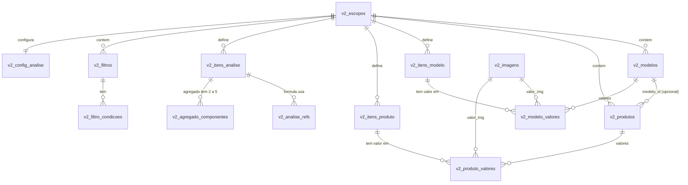

# Auxdec v2 — Etapa 1: modelo de dados e arquitetura

**Status:** proposta para revisão. Nada foi criado no Supabase nem no GitHub.
**Destino:** repositório `lucskydev/auxdec` · Supabase projeto "sistemas" (compartilhado) · prefixo `v2_` · localStorage `sistemaDecisoesV2:`

---

## 0. Decisões que preciso que você valide

O prompt mestre deixa alguns pontos ambíguos. Escolhi uma proposta para cada um; diga "ok" ou aponte a alternativa.

| # | Ponto | Proposta | Alternativa |
|---|---|---|---|
| D1 | Unicidade de nomes | Única **por tipo** dentro do escopo (itens de modelo, itens de produto, itens de análise, modelos, produtos, filtros). Conflito modelo × produto é bloqueado na associação **e também** ao criar depois um item com nome igual (no modelo ou no produto). | Um único namespace para os três tipos de item |
| D2 | Vazio × zero | `NULL` = vazio; `0` = zero preenchido. Item novo nasce vazio (exibido "—"). Em fórmulas, vazio vale 0. | Item numérico novo nasce com 0 |
| D3 | Imagens | Um campo de imagem guarda **uma** imagem. Várias fotos = vários itens de imagem. | Lista de imagens por campo |
| D4 | Ativação de filtros | Fica na sessão (localStorage `sistemaDecisoesV2:`), não no banco. O filtro salvo guarda só a definição. | Persistir "ativo" no banco |
| D5 | Indisponível e erro | Item de análise indisponível/erro propaga o mesmo estado. Componente de agregado ausente ou indisponível é excluído (com cobertura "2 de 3"). Componente **com erro** faz o agregado ficar em **erro** (não some em silêncio). | Excluir também os componentes com erro |
| D6 | Remover item de um modelo | Permitido com confirmação e lista de impactos (produtos e análises afetados). Excluir a **definição** do item é bloqueado se houver qualquer referência. | Bloquear também a remoção do modelo |
| D7 | Configuração de colunas da análise | É apresentação: ao excluir um item, ele sai das colunas/ordenações automaticamente, com aviso. O agregado do ranking é referência rígida (bloqueia a exclusão). | Bloquear exclusão por coluna visível |
| D8 | Peso do agregado (1–10) | Guardado e usado como sugestão ao incluí-lo em outro agregado. O peso efetivo é sempre o do componente. | Ignorar o peso do agregado |
| D9 | Roteamento no GitHub Pages | `HashRouter` (`/#/rota`): acesso direto nunca dá 404. | `BrowserRouter` + `404.html` |
| D10 | Testes de banco | `supabase start` (Docker) **só no CI** do GitHub Actions; nunca contra o projeto "sistemas". | Projeto Supabase separado de testes |

---

## 1. Isolamento da versão atual

Todo objeto novo começa com `v2_` (tabelas, funções, triggers, índices, views, policies, bucket). Nenhum objeto de `decisoes_*` é lido, alterado ou referenciado.

| Tipo | Nome |
|---|---|
| Bucket | `v2_imagens` (privado) |
| Policies de tabela | `v2_<tabela>_select_proprio`, `_insert_proprio`, `_update_proprio`, `_delete_proprio` |
| Policies de storage | `v2_img_select_proprio`, `v2_img_insert_proprio`, `v2_img_delete_proprio` (todas com `bucket_id = 'v2_imagens'`) |
| Auth do navegador | `storageKey: 'sistemaDecisoesV2:auth'` (as origens `/decisoes/` e `/auxdec/` compartilham localStorage) |

**Verificações somente de metadados (Etapa 2, antes do SQL):** listar tabelas e policies do projeto para confirmar que não há colisão de nomes, e ler o texto das policies atuais de `storage.objects` para confirmar que filtram por `bucket_id = 'decisoes-imagens'`. Policies permissivas se somam (OR): se alguma da versão atual não filtrar bucket, ela abriria acesso ao `v2_imagens`. Não leio linhas de dados.

**Exceção autorizada por você (regra 1):** `ALTER PUBLICATION supabase_realtime ADD TABLE public.v2_...`, apenas para tabelas `v2_`.

---

## 2. Modelo de dados

Convenções em **todas** as tabelas: `id uuid pk default gen_random_uuid()`, `user_id uuid not null default auth.uid()`, `created_at`, `updated_at`, e `versao int not null default 1` nas tabelas editáveis. Textos de domínio usam `text` + `check` (sem enums, que são difíceis de evoluir).

### 2.1 Diagrama de relações



### 2.2 Tabelas

**`v2_escopos`**: `nome`, `descricao`, `ultimo_acesso`, `versao`. Único `(user_id, lower(btrim(nome)))`. Único auxiliar `(id, user_id)` para FKs compostas.

**`v2_itens_modelo`** (atributo reutilizável de modelo): `escopo_id`, `nome`, `descricao`, `tipo` (`numerico|textual|imagem`), `unidade`, `casas_decimais`, `valor_min`, `valor_max`, `versao`. Único `(escopo_id, lower(btrim(nome)))`. Único auxiliar `(id, escopo_id)` e `(id, tipo)`. **`tipo` imutável** (trigger rejeita alteração). `check (valor_min <= valor_max)`; limites e unidade só para `numerico`.

**`v2_itens_produto`**: mesma estrutura de `v2_itens_modelo`, namespace próprio.

**`v2_modelos`**: `escopo_id`, `nome`, `descricao`, `versao`. Único `(escopo_id, lower(btrim(nome)))`, auxiliar `(id, escopo_id)`.

**`v2_produtos`**: `escopo_id`, `nome`, `descricao`, `modelo_id` (nullable), `versao`. Único `(escopo_id, lower(btrim(nome)))`. FK composta `(modelo_id, escopo_id) → v2_modelos(id, escopo_id)` com `NO ACTION`: impede modelo de outro escopo e impede excluir modelo com produtos.

**`v2_modelo_valores`**: a **linha existir** = o item pertence ao modelo. Colunas: `modelo_id`, `item_modelo_id`, `escopo_id`, `tipo`, `valor_num numeric`, `valor_txt text`, `valor_img_id uuid`. PK `(modelo_id, item_modelo_id)`. FKs compostas `(modelo_id, escopo_id)`, `(item_modelo_id, escopo_id)` e `(item_modelo_id, tipo)`. `check`: só a coluna do `tipo` pode ser não nula. Trigger: valor numérico dentro de `valor_min/valor_max` do item.

**`v2_produto_valores`**: igual, para itens próprios do produto.

**`v2_imagens`**: `escopo_id`, `storage_path` (único), `largura`, `altura`, `bytes`, `mime`. Caminho: `{user_id}/{escopo_id}/{uuid}.webp`.

**`v2_itens_analise`**: `escopo_id`, `nome`, `descricao`, `tipo` (`formula|agregado`, imutável), `formula_texto`, `peso` (1–10, só agregado), `versao`. Único `(escopo_id, lower(btrim(nome)))`. `check`: fórmula exige `formula_texto`; agregado exige `peso`.

**`v2_analise_refs`** (dependências de fórmula, derivadas do texto no momento de salvar): `analise_id`, `escopo_id`, exatamente uma entre `item_modelo_id | item_produto_id | item_analise_id` (`check num_nonnulls = 1`). FKs compostas com `NO ACTION`, o que dá o bloqueio de exclusão no banco.

**`v2_agregado_componentes`**: `agregado_id`, `ordem`, `peso` (1–10), `direcao` (`maior|menor`), `lmin`, `lmax` (`check lmin <> lmax`), mais as mesmas 3 colunas de referência com `num_nonnulls = 1`. Deve ter 2 a 5 por agregado (constraint trigger *deferred*, verificada no commit). Referências a item de modelo/produto só aceitam `tipo = 'numerico'`.

**`v2_filtros`**: `escopo_id`, `nome`, `descricao`, `logica` (`AND|OR`), `versao`. Único por nome no escopo.

**`v2_filtro_condicoes`**: `filtro_id`, `ordem`, 3 colunas de referência (`num_nonnulls = 1`), `operador` (`=,≠,<,>,≤,≥`), `valor_num`, `valor_txt`. Trigger: texto só aceita `=` e `≠`; imagem não é filtrável.

**`v2_config_analise`**: uma linha por escopo (`escopo_id` único): `modo`, `logica_global`, `agregado_ranking_id` (FK `NO ACTION` para `v2_itens_analise`), `colunas jsonb` (visíveis, ordem, fixadas, larguras), `ordenacao jsonb`, `versao`.

### 2.3 Integridade entre escopos

Toda tabela filha carrega `escopo_id` e `user_id`, e as FKs são **compostas** `(id, escopo_id)` / `(escopo_id, user_id)`. Assim o banco recusa qualquer ligação entre escopos ou usuários diferentes, sem depender do frontend.

---

## 3. Regras de negócio e onde cada uma é garantida

| Regra | Garantia no banco |
|---|---|
| Nomes únicos sem distinção de caixa por escopo | Índices únicos em `lower(btrim(nome))` |
| Sem referências órfãs / entre escopos | FKs compostas |
| Tipo imutável (itens e análises) | Trigger `v2_bloqueia_troca_tipo` |
| Modelo com produtos não pode ser excluído | FK `v2_produtos → v2_modelos` `NO ACTION` |
| Item referenciado não pode ser excluído | FKs de `refs`, `componentes`, `condicoes`, `config` `NO ACTION` |
| Conflito de nomes herdado × próprio | Trigger ao mudar `modelo_id`, ao inserir em `modelo_valores` e em `produto_valores` (D1) |
| Limites numéricos | Trigger de valor; ao editar `valor_min/max` do item, bloqueia se houver valores fora |
| Agregado com 2–5 componentes, peso 1–10, `lmin ≠ lmax` | `check` + constraint trigger deferred |
| Sem ciclos | Constraint trigger deferred com CTE recursivo sobre `analise_refs` e `agregado_componentes` (inclui autorreferência) |
| Texto da fórmula coerente com suas referências | RPC confere que todo token `[[tipo:uuid]]` do texto está em `analise_refs` |
| Concorrência (versão) | Seção 5 |
| Exclusão com NO ACTION permite cascata de escopo | Exclusão do escopo remove tudo no mesmo comando |

**Limite honesto:** a *sintaxe* da fórmula é validada pelo avaliador TypeScript antes de salvar. O banco garante existência, escopo, tipo, ciclos e consistência das referências, mas não interpreta a gramática.

---

## 4. Herança modelo → produto

Sem cópias. O produto guarda apenas `modelo_id` e seus valores próprios. Os valores herdados são lidos de `v2_modelo_valores` do modelo associado, via view `v2_vw_produto_efetivo` (junção por `modelo_id`). Mudou o valor no modelo, todos os produtos associados mudam, pois não há cópia que possa divergir.

- Sobrescrita individual de valor herdado: não existe (sem coluna para isso).
- Produto sem modelo: `modelo_id = null`, só itens próprios.
- Linhas de **modelo** na análise não têm itens de produto: essas células são "não aplicável" (distinto de vazio).

---

## 5. Salvamento manual e controle de versão

- **Linha simples** (escopo, item, modelo...): trigger `BEFORE UPDATE` exige `NEW.versao = OLD.versao + 1`. O cliente envia `versao = esperada + 1`. Se outra sessão salvou antes, `OLD.versao` mudou e o `UPDATE` falha com erro `conflito_versao`. Omitir `versao` também falha. A checagem ocorre dentro do bloqueio da linha, portanto é atômica e não dá para contornar pela API.
- **Registro com filhos** (produto + valores, modelo + valores, agregado + componentes, fórmula + refs, filtro + condições): RPC `v2_salvar_*(p_id, p_versao_esperada, ...)`. Trava a linha pai (`FOR UPDATE`), confere a versão, grava pai e filhos na mesma transação e incrementa a versão do pai. A versão do pai cobre os filhos. As RPCs são `SECURITY DEFINER` com `search_path = ''`, filtro explícito `user_id = auth.uid()` e `EXECUTE` revogado de `anon`/`public`. Escrita direta nas tabelas filhas é revogada para `authenticated`.
- No conflito: o cliente mantém o rascunho, busca a versão atual, mostra as diferenças e o usuário reaplica manualmente.
- Nenhum auto-save. Sucesso só é mostrado após o retorno do Supabase.

---

## 6. RLS e Storage

- RLS ativo em **todas** as tabelas `v2_`. Policies `to authenticated` para select/insert/update/delete com `(select auth.uid()) = user_id` (e `with check` igual). Nenhuma com `using (true)`. `anon` sem privilégio algum.
- Storage: bucket `v2_imagens` privado, imagens servidas por URL assinada. Policies em `storage.objects` filtradas por `bucket_id = 'v2_imagens'` e `(storage.foldername(name))[1] = auth.uid()::text` (select, insert, delete). Sem update: troca de imagem = novo arquivo.
- Frontend usa só a chave anon/publishable. `service_role` nunca entra em arquivo, commit ou chat.
- Testes de segurança (CI com Supabase local): usuário anônimo e usuário B não leem nem escrevem dados do usuário A; upload fora da própria pasta é negado.

---

## 7. Imagens

Redimensionamento no navegador (máx. 800×600, proporção preservada, WebP) antes do upload. Fluxo: envia o arquivo → grava `v2_imagens` e o valor via RPC → em falha, remove o arquivo enviado. Ao trocar ou excluir, a RPC devolve o caminho antigo e o cliente remove o objeto. **Limitação:** sem servidor próprio, o banco não apaga arquivos do Storage atomicamente; uma falha de rede entre os passos pode deixar um arquivo órfão. Mitigação: rotina "limpar órfãos" que compara `storage.objects` do bucket com `v2_imagens`.

---

## 8. Fórmulas, agregados e ranking (módulos TypeScript puros)

Resultados **não são persistidos**: são calculados no cliente a partir dos dados carregados, e por isso nunca ficam desatualizados.

- **Fórmula:** texto armazenado com tokens por id (`[[m:uuid]]`, `[[p:uuid]]`, `[[a:uuid]]`); o editor mostra nomes legíveis, então renomear não quebra nada. Parser próprio (Pratt/descida recursiva), sem `eval`. Precedência: `NOT` > `* /` > `+ -` > comparações > `AND` > `OR`. Comparações geram booleano; `IF` exige booleano; o resultado final precisa ser número. `COUNT` conta informados (inclui 0, exclui vazios); demais usos tratam vazio como 0; divisão por zero gera erro na célula, sem afetar outras linhas.
- **Agregado:** pontuação normalizada `10·(v−Lmin)/(Lmax−Lmin)` (ou invertida), saturada em 0–10; média ponderada `Σ(peso·nota)/Σ(pesos válidos)`; sem critério válido → **indisponível** (nunca 0); mostra cobertura; sem arredondamento intermediário (usar `number` com ordenação/empates pela precisão interna).
- **Ranking:** competitivo (1º, 1º, 3º), empates pela precisão interna, indisponível sem posição.
- **Filtros:** AND/OR interno por filtro + AND/OR global entre filtros ativos.
- **Análise:** todos os dados do escopo carregados de uma vez, virtualizados (`@tanstack/react-virtual`). CSV e PDF usam o conjunto de linhas da consulta, não o DOM.

---

## 9. Backup, importação e exclusão de escopo

- **Backup:** `.zip` com `backup.json` (`formato: "auxdec-backup"`, `versao_formato: 1`, sem segredos) e as imagens. IDs internos preservados dentro do arquivo.
- **Importação:** valida formato, versão, referências, duplicados, tipos, fórmulas, ciclos e presença das imagens; mostra resumo; envia as imagens para novos caminhos; chama `v2_importar_escopo(p_payload jsonb, p_modo)`, que gera **novos ids e remapeia todas as referências** numa única transação. Falha → nada muda e as imagens enviadas são removidas. "Substituir escopo" só dentro da mesma RPC, após backup confirmado.
- **Excluir escopo:** exige backup concluído e confirmação reforçada (digitar o nome); a RPC `v2_excluir_escopo` apaga tudo numa transação e devolve os caminhos de imagem para o cliente removê-los do Storage.

---

## 10. Realtime

`REPLICA IDENTITY FULL` nas tabelas `v2_` (são minhas) e inclusão na publication `supabase_realtime`. Assinatura por escopo ativo. Atualização remota entra direto nos dados não editados; se há rascunho local da mesma linha, avisa e preserva. Limitação conhecida do Realtime: eventos de `DELETE` não podem ser filtrados por coluna, então o cliente descarta os que não pertencem ao escopo ativo. Desconexão: reconexão automática e recarga completa do escopo ao reconectar.

---

## 11. Arquitetura do frontend

React + TypeScript + Vite · `react-router` (Hash) · TanStack Query, Table e Virtual · Zod · `@supabase/supabase-js` · jsPDF + autotable · JSZip · Vitest + Testing Library (+ Playwright para fluxos críticos).

```
src/
  app/            rotas, layout, menu lateral, tema escuro
  features/       escopos, modelos, produtos, itens, analise, filtros, backup
  domain/         tipos, validações Zod, unicidade
  engine/         parser e avaliador de fórmulas, normalização, agregados, ranking, filtros, ordenação
  data/           cliente Supabase, repositórios, RPCs, realtime, versão/conflito
  export/         csv.ts, pdf.ts
  components/     tabela virtualizada, diálogos, popovers, toasts
supabase/migrations/   v2_0001_...sql (versionadas)
supabase/tests/        testes de RLS, versão, herança, ciclos
docs/                  este documento e os demais
```

Variáveis: `VITE_SUPABASE_URL`, `VITE_SUPABASE_ANON_KEY` (em `.env.example`; `.env*` no `.gitignore`). `vite.config.ts` com `base: '/auxdec/'`.

---

## 12. Testes, CI e implantação

- **CI** (`.github/workflows`): instalar → `tsc --noEmit` → lint → unitários → `supabase start` + testes de integração/RLS → build → deploy no Pages (só se tudo passar).
- **Unitários:** tudo da seção 21.1 do prompt (motor de fórmulas, normalização, agregados, ranking, filtros).
- **Integração/segurança:** RLS, Storage, herança, bloqueios de exclusão, ciclos, conflito de versão, importação/exportação.
- **Nunca** executar testes que escrevem dados contra o projeto "sistemas".
- Migrações aplicadas ao projeto "sistemas" **uma a uma**, cada uma precedida da lista de objetos afetados e da sua confirmação.

---

## 13. Riscos conhecidos

1. Projeto compartilhado: a publication do Realtime e o histórico de migrações são globais. Mitigação: só adicionar tabelas `v2_`, só migrações `v2_`.
2. Origem compartilhada no navegador (`github.io`): mitigada por `storageKey` e prefixo próprios.
3. Imagens órfãs no Storage (seção 7).
4. Fórmulas: sintaxe validada no cliente; o banco valida só referências e estrutura.
5. Volume: sem paginação, o escopo inteiro é carregado. Adequado a uso doméstico; revisar se passar de alguns milhares de linhas.

---

## 14. Próximo passo

Após sua revisão: Etapa 2 (metadados de colisão + migrações SQL e testes de segurança), sem aplicar nada antes de listar os objetos afetados e receber sua confirmação.
